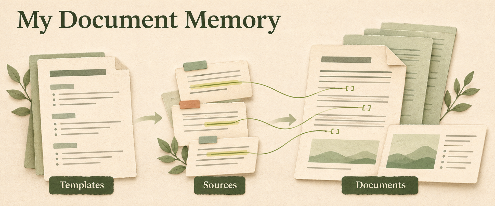
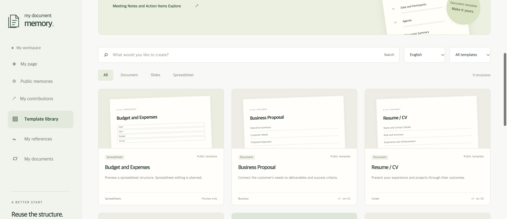
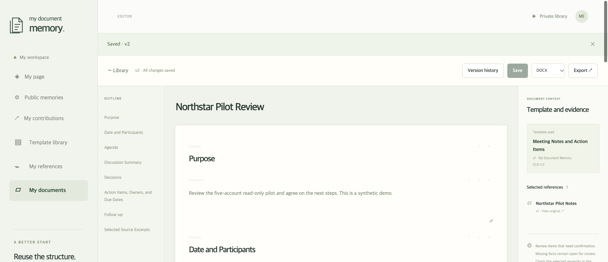
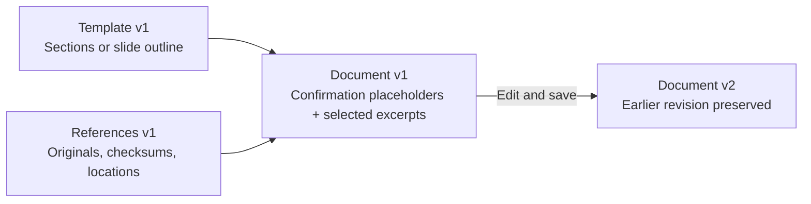
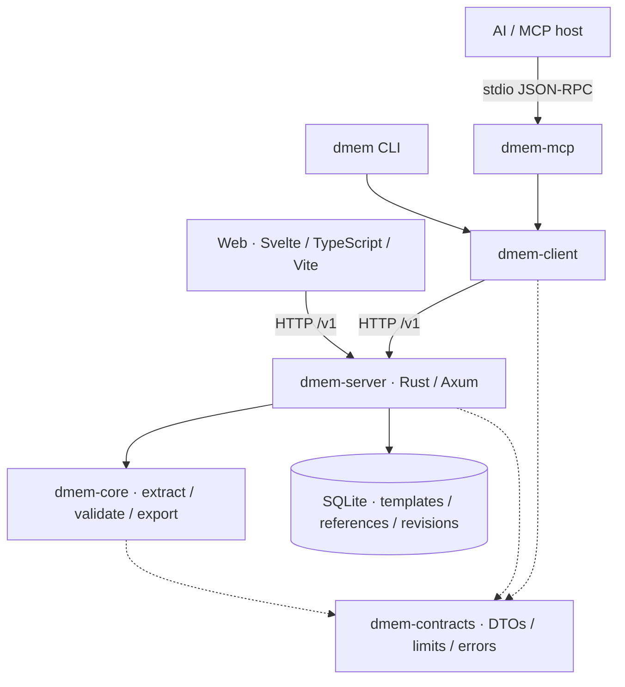

# My Document Memory

**[Try the web app](https://mydocumentmemory.com) · [Browse free templates](https://mydocumentmemory.com/#public)** — no installation needed. Sign in with an email link to save your own library.



> The era of writing documents yourself is ending.

**We are building a service where people share document memory, so anyone can create the document they need with AI, easily and for free.**

Keep useful structures, writing rules, and ways to use references as reusable memory. One person's writing experience can become a better starting point for another person and their AI.

Anyone can browse, search, and preview public memories without signing in. Individuals can [create a free account](https://mydocumentmemory.com/#signup) with a personal email address. Contribution requests require a registered, signed-in account; follow Awaiting review, Approved · Public, Rejected, and Withdrawn states in My contributions.

Available today: reusable templates, reference import, editable document and slide outlines, revision history, and export. The web app creates template-based outlines; connect your own AI host for model-written drafts. [Current scope](#current-scope).

[Quick start](#quick-start) · [Connect your agent](#connect-your-agent) · [How it works](#how-it-works) · [The problem](#the-problem) · [Our vision](#our-vision) · [Examples](#what-my-document-memory-does) · [Expected savings](#expected-time-and-tool-call-savings) · [Free templates](#start-free-with-the-ai-you-choose) · [Architecture](#architecture) · [Development](#development)

## The Problem

People spend too much time preparing documents. A report, proposal, resume, or presentation starts with finding a template, choosing sections, gathering evidence, and arranging the content.

Useful structures and writing know-how often stay buried in individual files. A finished document rarely explains why its sections are ordered that way, which questions need review, or what evidence supports its claims. Repeating those instructions for every AI task adds more preparation.

Two recurring problems make this harder:

- **Formats drift when platforms or models change.** Switching document-writing web platforms or AI models can produce inconsistent outlines, tone, and required sections, even for the same task.
- **Lower-cost models can struggle with document writing.** A brief prompt may not give them enough guidance to produce a well-structured draft that follows your writing standard.

Document memory helps address both problems by making templates, writing rules, examples, and review criteria reusable across tools and models. Add the references for each task so your AI has both a writing standard and evidence to work from.

## Our Vision

**Shared document memory that helps anyone start from the template they need and create with AI.**

1. **Share writing experience.** Keep useful templates, guidance, and review criteria as memory. Choose what to contribute.
2. **Give AI a useful starting point.** Find the structure and rules for the task, then select the references that support its facts.
3. **Make creation accessible.** Help people start with a suitable template, review the content, and make it their own.

Someone writing a first business plan should be able to start with an experienced writer's outline and questions, add their own evidence, and build a draft with AI. Our goal is less preparation and more time for thinking, deciding, and acting.

The current runtime provides the library, editor, CLI, and MCP foundation. The web app builds deterministic draft outlines from templates and selected excerpts; it does not call an LLM. Use a connected AI host to work with a model. AI provider costs depend on the service you choose.

## What My Document Memory Does

Keep the templates and writing practices you use on the web as document memory, then give a connected AI the same starting point. The product direction includes reports in Docs, decks in Slides, project pages in Notion, and blog drafts for Medium or Naver.

| Web workspace | Example request | Structure and review criteria to remember |
|---|---|---|
| [Google Docs](https://workspace.google.com/products/docs/) | "Use this week's notes to write a report in last week's format." | Summary, progress, issues, next steps, tables, and citations |
| [Google Slides](https://workspace.google.com/products/slides/) | "Turn this idea into our pitch deck format." | Problem, solution, evidence, proposal, slide roles, and outline approval |
| [Notion](https://www.notion.com/) | "Create a project plan in our team's format." | Background, goals, owners, timeline, checklist, and terminology |
| [Medium](https://medium.com/) | "Turn these notes into a post in my technical blog style." | Opening, headings, examples, closing, tone, and reference links |
| [Naver Blog](https://section.blog.naver.com/BlogHome.naver) | "Organize this experience using my usual review format." | Introduction, experience, practical details, summary, photo positions, and voice |

### A consistent standard across platforms and models

Carry the same outline, tone, required sections, and review criteria across web writing platforms and AI models. Use the same writing standard when moving between tools such as Google Docs and Notion or choosing a different model, so the format does not need to be reinvented each time. Choose a template and task-specific references, let your connected AI work from that memory, then review and finish in a familiar web workspace.

Direct work inside each external service depends on the connected host and browser tools. The runtime's built-in creation tool currently creates an editable outline; provider synchronization and publishing are separate work.

## Expected Time and Tool-Call Savings

**Less repeated setup: approximately 46% less task time and 34% fewer tool calls, as an illustrative planning estimate.**

For repeat work such as Google Slides decks, Google Docs reports, and Notion project pages, reuse the structure, writing rules, and references instead of asking your AI to rediscover the same workflow each time.

| Illustrative task | Starting point | With reusable memory (estimate) |
|---|---:|---:|
| Task time | 10 minutes | About 5 minutes 24 seconds |
| Tool calls | 100 | About 66 |

These estimates take inspiration from [WAM's 2026-10-16 editor pilot](https://github.com/heycodingkr/web-agentic-memory/blob/f0fdcb434916cb5ed6819546ac12ce00a3fe5e0d/web/src/lib/landing.ts#L63): the three English editor scenarios averaged about 46% less time and 34% fewer calls, with one run per condition. The example above applies those rounded percentages to a hypothetical task. Actual savings depend on the task and connected tools; **My Document Memory has not yet been benchmarked.**

## Start Free, with the AI You Choose

**Use free templates and a lightweight AI such as Luna to prepare documents for Google Docs, Google Slides, or Notion.** Choose a useful starting point, give your connected AI the structure and sources, then review the result in the tools you already use.

- **Reuse different templates for free.** Start with report, meeting-note, project-plan, or pitch-deck structures. Keep the outline, tone, required sections, and review criteria as reusable memory.
- **Help lower-cost models write better.** Give a lightweight model such as Luna a saved outline, writing rules, examples, review criteria, and selected references through your connected AI host. This gives it a concrete standard to follow instead of having to infer the document's structure from a short prompt alone. Review its facts and open questions before finishing.
- **Continue in free document tools.** Export DOCX for [Google Docs](https://workspace.google.com/products/docs/), PPTX for [Google Slides](https://workspace.google.com/products/slides/), or Markdown for [Notion](https://www.notion.com/pricing). Docs and Slides offer free editing with a Google Account; Notion offers a Free plan.

Browsing and reusing our templates is free. AI host, model, and API costs depend on your provider, and third-party plan limits apply. The current web app creates a template-based outline; your connected AI writes with a model. Direct editing inside another service depends on compatible host/browser tools.

### Early evidence: Luna + reusable memory

The related **Web Agentic Memory (WAM)** project tested a Canva workflow with `gpt-6-luna/max` on 2026-10-31. Both conditions completed the full editing/export task and independent file checks. [Original WAM Canva R7 report](https://github.com/heycodingkr/web-agentic-memory/blob/04cb13318acb0c7dff7734b6613325c361deb827/docs/test/benchmarks/canva.md).

| WAM condition | Observed runtime | External tool boundaries |
|---|---:|---:|
| Tools only | 473.976 s | 123 |
| Supplied WAM memory hints | 423.193 s | 106 |

This is a preliminary observation: one run per condition, different templates and upload paths, higher reported tokens with hints, and unmeasured billing. It does not establish general speed or cost savings. **My Document Memory's own document-writing benchmarks are pending.**

## How it works



*App screenshots use actual English starter templates and synthetic references. The top illustration is a product concept.*

1. **Bring your references.** Import TXT, Markdown, basic DOCX, or PPTX files. Keep the original file, checksum, extracted text, and source locations.
2. **Choose a structure.** Preview a template, copy it into your private library, or create your own. English is the default; Korean templates are available through the language filter.
3. **Select the evidence.** Set a title and choose references. Review and approve the slide outline before creating a deck.
4. **Copy the request to your agent.** The template preview shows an **Agent prompt** with the exact selected IDs, expected versions, and creation arguments. **Copy prompt** copies that visible request. If clipboard access is blocked, the request is selected for manual copying.
5. **Review, edit, and save.** Complete the document or slides, inspect the evidence, and save a new revision.
6. **Export and continue.** Download DOCX, PPTX, Markdown, or HTML. Use browser printing for PDF. Open or import exported files in the document tools you know.

Drafts contain confirmation placeholders such as `{{Needs confirmation: Purpose}}`. Each selected reference contributes its first three extracted source locations as evidence blocks or slides. English templates use English labels; Korean templates retain Korean labels.



*The actual editor after saving an English document with synthetic project notes.*

## Quick start

1. Open [mydocumentmemory.com](https://mydocumentmemory.com).
2. Browse the public template library and preview a template.
3. Sign in with an email link to keep your own library and contribute templates.

You can use the hosted web app without installing anything or starting a local server.

| Service | Public address |
|---|---|
| Web app | [https://mydocumentmemory.com](https://mydocumentmemory.com) |
| HTTP API base | `https://api.mydocumentmemory.com` |
| API health | [https://api.mydocumentmemory.com/healthz](https://api.mydocumentmemory.com/healthz) |

```sh
curl --fail https://api.mydocumentmemory.com/healthz
# {"ready":true}
```

Public templates are available at [`/v1/public/templates`](https://api.mydocumentmemory.com/v1/public/templates). Private library routes require authentication. For a local checkout, see [Local development](#local-development).

## Connect your agent

CLI and MCP can connect to the hosted API at `https://api.mydocumentmemory.com`. Build the local client binaries from a source checkout with Rust 1.89 or later:

```sh
cargo build --locked -p dmem-cli -p dmem-mcp
```

Private CLI/MCP access currently requires a separately provisioned library token in `DMEM_TOKEN`. Email sign-in creates a browser session; it does not issue a CLI/MCP token.

### CLI

Set `DMEM_TOKEN` through your private environment, then select the hosted API:

```sh
export DMEM_URL=https://api.mydocumentmemory.com
./target/debug/dmem status
./target/debug/dmem templates 'Meeting'
./target/debug/dmem import ./my-notes.md --title 'Project Notes'
./target/debug/dmem create meeting.minutes.en --title 'Project Kickoff'
./target/debug/dmem --help
```

Include a returned source ID with `--source`; repeat the option for multiple references. Deck creation requires `--approve-outline` after reviewing the outline. Results are JSON. Export refuses to overwrite an existing file.

To install user commands:

```sh
cargo install --path crates/dmem-cli --locked --debug
cargo install --path crates/dmem-mcp --locked --debug
```

### stdio MCP

Register the absolute path to your built or installed executable with an MCP host. Supply `DMEM_TOKEN` through the host's private environment or secret settings. The local stdio adapter connects to the hosted HTTP API; there is no remote `/mcp` endpoint.

```json
{
  "mcpServers": {
    "document-memory": {
      "command": "/absolute/path/my-document-memory/target/debug/dmem-mcp",
      "env": {
        "DMEM_URL": "https://api.mydocumentmemory.com"
      }
    }
  }
}
```

Call `document_memory_status` to verify the connection. Select a template and references in the web library, then copy the visible request. Its JSON records exact IDs and expected versions without including the token or reference body.

| Tool | Purpose |
|---|---|
| `document_memory_status` | Supported formats, capabilities, and vocabulary |
| `document_template_search` | Find reusable structures |
| `document_source_search` | Find private references and source spans |
| `document_memory_list` | List saved documents |
| `document_memory_get` | Read a document and its pinned versions |
| `document_template_copy` | Copy a template privately with attribution |
| `document_memory_create` | Create an editable draft from selected IDs |
| `document_memory_recall` | Recall accessible memory by URL, form and keywords |
| `document_template_save` · `document_template_get` | Save and read private reusable structures |
| `document_memory_save` | Save an edited document revision with conflict detection |
| `document_public_template_search` · `document_public_template_get` | Search and read approved public structures without a token |
| `document_contribution_submit` · `document_contribution_list` | Explicitly submit a structure snapshot and follow its review |
| `document_contribution_check` · `document_contribution_withdraw` | Read safe review findings or withdraw your contribution |

Copying a template and copying a prompt are separate actions. Copying a prompt does not create a document. Deck requests remain disabled until their outline is approved.

## Administrator review

Open [Contribution review](https://mydocumentmemory.com/#review) to request an administrator sign-in link. Only email addresses explicitly configured by the operator can receive it. Confirm the single-use link within 10 minutes; the separate administrator session lasts two hours. Review the submitted structure and findings, then explicitly approve or reject it. **Sign out and lock queue** revokes the session.

Administrator access is separate from ordinary member sign-in and CLI/MCP library tokens. Browser reviewers do not enter an operator token. The operator configures the exact email allowlist through `DMEM_ADMIN_EMAILS`; an empty list disables administrator sign-in. See [administrator setup and starter memories](docs/spec/admin-email-starters-v1.md).

## Contribute and review a structure

The local review runtime supports private save/read and the public contribution lifecycle from the web, CLI, and 17 stdio MCP tools. Public search/read works without `DMEM_TOKEN`; private operations use the token's library owner. Browser email accounts and separately provisioned library tokens remain distinct identities.

```sh
# Against your running local server:
export DMEM_URL=http://127.0.0.1:3847
./target/debug/dmem public-templates 'Meeting'
./target/debug/dmem template-save ./template.json
./target/debug/dmem template-show <TEMPLATE_ID>
./target/debug/dmem contribute <TEMPLATE_ID> --author 'Public name' --license CC-BY-4.0 --rights-confirmed
./target/debug/dmem contributions
./target/debug/dmem contribution-check <CONTRIBUTION_ID>
```

A template input contains `title`, `summary`, `form` (`provider`, `doc_type`, `locale`), `sections`, and optional `tags`. Saving keeps it private. Submission copies only its structure into an immutable pending snapshot.

Review runs submission checks → privacy/injection → license/attribution → duplicate comparison → structure validation → explicit administrator decision. Secret or personal-data findings block approval, including direct API/CLI attempts. Duplicate structures are flagged for human judgment. Review findings contain fixed codes and field names. Decisions, timestamps, and the exact snapshot hash persist in SQLite.

Open `/#review`, request a sign-in link for an allowlisted administrator email, confirm it, and inspect **Review contributions**. Operator CLI access remains separate: supply a configured `DMEM_ADMIN_TOKEN` through a private environment and run:

```sh
# Set DMEM_ORIGIN to the server's allowed web origin when it differs from DMEM_URL.
./target/debug/dmem review-queue
./target/debug/dmem review <CONTRIBUTION_ID>
./target/debug/dmem decide <CONTRIBUTION_ID> --decision approve
```

The web uses a separate HttpOnly administrator session and **Sign out and lock queue**; administrator tokens are not entered or saved in browser storage. A passing check stays pending until approval; approved structures can be copied privately with attribution. Withdrawal stops new public reads/copies and preserves existing copies.

[Workflow contract](docs/spec/memory-community-smoke-v1.md) · [Test inputs and results](docs/test/memory-community-smoke-v1.md). The repeatable local checks are `python3 tests/smoke/community-v1.py` and `python3 tests/smoke/accounts-v1.py` after building the workspace, account fixture, and web assets.

## What is stored?

| Record | Contents |
|---|---|
| **Template** | Sections or slide outline, document type, locale, author, and license |
| **Reference** | Original file, SHA-256 checksum, extracted text, and source locations |
| **Document** | Editable blocks or slides, pinned versions, citations, and revisions |



Citations identify `source_id`, `source_version`, and `span_id`. Saving creates a new immutable revision. The server rejects stale `base_version` values with `version_conflict`.

## Architecture

The web app calls the server over HTTP. CLI and MCP use a shared client. The server owns authentication, access checks, and transactions; core document processing works independently of HTTP and storage.



| Component | Responsibility |
|---|---|
| [web](web/) | Library, reference selection, editor, history, and export UI |
| [contracts](crates/dmem-contracts/) | Shared DTOs, input limits, and fixed errors |
| [core](crates/dmem-core/) | Normalization, extraction, validation, and export |
| [server](crates/dmem-server/) | HTTP API, authentication, ownership, SQLite, and migrations |
| [client](crates/dmem-client/) | Shared HTTP authentication and request/error handling |
| [CLI](crates/dmem-cli/) · [MCP](crates/dmem-mcp/) | Terminal commands and agent tools |

The workspace boundaries draw on [Web Agentic Memory](https://github.com/heycodingkr/web-agentic-memory); see the [port map](docs/design/wam-port-map.md). SQLite provides a complete local library without another database service. PostgreSQL, object storage, and workers belong to later scaling work.

## Current scope

Use the [runtime contract](docs/spec/runtime-v1.md), [account and community specification](docs/spec/accounts-community-v1.md), and [English handoff specification](docs/spec/english-handoff-v1.md) alongside the code. [Account setup and operations](docs/spec/accounts-operations-v1.md) describes private credentials and the deployed service.

- Resend email-link sign-in and signup, private accounts, persistent sessions, My page, and personal template/reference/document/contribution counts.
- Opt-in public contributor profiles and a [leaderboard](https://mydocumentmemory.com/#leaderboard). My page separates private overall rank from public rank. Each approved template earns 20 contribution points while it remains public. [Member specification](docs/spec/member-leaderboard-v1.md).
- Anonymous public templates, private copies with preserved attribution, contribution submission, administrator review, and withdrawal. [Verified results](docs/test/accounts-community-v1-results.md).
- 42 original built-in templates and writing memories, 21 each in English and Korean. The original 18 starter IDs and versions are preserved; 24 additions cover planning, product requirements, decisions, research, incident reviews, technical writing, evidence, voice, quality checks, and slide stories.
- Search, language/type/visibility filters, private copies, custom templates, and source-derived structures.
- TXT/Markdown/basic DOCX/PPTX import up to 10 MiB per file with original preservation and separate reference search.
- Document blocks, editable slides, citations, immutable saved revisions, and conflict detection.
- Markdown/HTML, DOCX, PPTX, and browser printing for PDF.
- Shared HTTP client, CLI, and stdio MCP tools.

Spreadsheet editing/formulas, provider synchronization, remote URL import, PDF import/OCR, and faithful reconstruction of complex Office layouts are outside this runtime. Wider product specifications include future work.

In local token mode the API binds to loopback, and `/v1` library requests require authorization. `/healthz` is a readiness endpoint. The browser stores the connection token in tab-scoped `sessionStorage`. Templates and factual references are searched separately.

## Development

### Local development

Install Rust/Cargo, Node.js, and pnpm. The workspace requires Rust 1.89 or later.

```sh
node scripts/dev.mjs
```

Run from the repository root. The first run creates a random `DMEM_TOKEN` in `.env`, installs missing web dependencies, builds the API server, and starts API and Vite.

1. Open [http://127.0.0.1:5174](http://127.0.0.1:5174).
2. Enter `DMEM_TOKEN` from your local `.env` in **Library connection token**.
3. Click **Open library** and preview **Meeting Notes and Action Items**.

Default ports are API `3847` and web `5174`. Reuse an existing server. The supervisor stops only its own processes. Your data and revision history persist in `data/dmem.sqlite3`. A deployed library can use a separate token and database.

### Configuration (local development)

These defaults are for a local checkout. Hosted clients use `DMEM_URL=https://api.mydocumentmemory.com`. On the production server, `DMEM_ADDR=127.0.0.1:3848` is the internal listener behind Caddy; it is separate from the public API address.

See [.env.example](.env.example). The development supervisor reads `.env`; existing environment variables take precedence. CLI and MCP binaries require their environment variables explicitly.

| Variable | Default or requirement | Purpose |
|---|---|---|
| `DMEM_TOKEN` | Required; generated on first development run | Library token, at least 16 characters |
| `DMEM_ADDR` | `127.0.0.1:3847` | API listener; loopback only |
| `DMEM_DATABASE` | `data/dmem.sqlite3` | SQLite database |
| `DMEM_WEB_ORIGIN` | `http://127.0.0.1:5174` | Allowed web origin |
| `DMEM_WEB_DIR` | `web/dist` | Built web assets served by Rust |
| `DMEM_URL` | `http://127.0.0.1:3847` | API base URL for CLI and MCP |

<details>
<summary>Serve the built web app and API from one process</summary>

Use the generated `.env`, or copy `.env.example` and configure a random token.

```sh
cargo build --workspace --locked
pnpm --dir web install --frozen-lockfile
pnpm --dir web build
set -a
. ./.env
set +a
./target/debug/dmem-server
```

Open [http://127.0.0.1:3847](http://127.0.0.1:3847).

</details>

For local CLI/MCP use, set `DMEM_URL=http://127.0.0.1:3847` and use the token generated in your local `.env` instead of the hosted library token.

### Checks

Build the real product and its synthetic account fixture before running smoke tests:

```sh
pnpm --dir web install --frozen-lockfile
cargo fmt --all --check
cargo test --workspace --locked
cargo build --workspace --locked
cargo build -p dmem-server --example accounts_fixture --locked
pnpm --dir web check
pnpm --dir web build
python3 tests/smoke/runtime-v1.py --browser
python3 tests/smoke/accounts-v1.py
python3 tests/smoke/community-v1.py
python3 -I tests/smoke/recall-v1.py
node --test demo/video/*.test.mjs
```

Install Playwright Chromium first if needed:

```sh
pnpm --dir web exec playwright install chromium
```

| Smoke target | What it verifies |
|---|---|
| `runtime-v1.py --browser` | Import, copy, create, edit, revisions, export, CLI/MCP, restart persistence, prompt copying/fallback, outline approval, and desktop/mobile UI |
| `accounts-v1.py` | Synthetic email links, private account isolation, administrator review, queue pagination, public copy/withdrawal, profiles, and leaderboard |
| `community-v1.py` | Real CLI/MCP private/public workflows, blocked approval, attribution, and independent HTTP/SQLite checks |
| `recall-v1.py` | Real HTTP/CLI/MCP recall, ownership boundaries, and safe errors |

These checks use temporary databases and synthetic credentials. Account tests capture email locally; the runtime-only browser run explicitly skips tests that require that fixture or live email opt-in. The broader Python contract suite defaults to a test double; its results are separate from these Rust product checks.

For the hosted deployment, `python3 tests/smoke/public-api-v1.py --env <private-env-file>` performs read-only HTTPS, catalog, authentication, CORS, and Origin checks using a separately provisioned library token. Keep its credential file private.

Office exports are checked as ZIP/XML and text; native Word/PowerPoint rendering requires a separate review. These smoke tests do not measure AI writing quality or editing inside external providers.

[Latest smoke audit](docs/test/landing-readme-smoke-audit-v1.md) · [Landing screenshot](docs/assets/landing-en.png) · [English handoff verification](docs/test/english-handoff-v1.md) · [Design review](docs/design/english-handoff-v1-review.md)

## Further reading

[Product overview](docs/spec/overview.md) · [Specification index](docs/spec/README.md) · [Architecture design](docs/design/architecture.md) · [Test harness](tests/README.md) · [Concept video](docs/demo/demo-video.md)

The concept video illustrates the product direction. README screenshots show the actual app.
